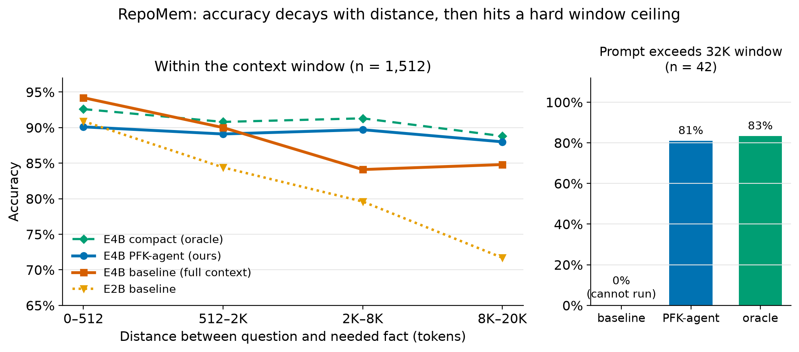
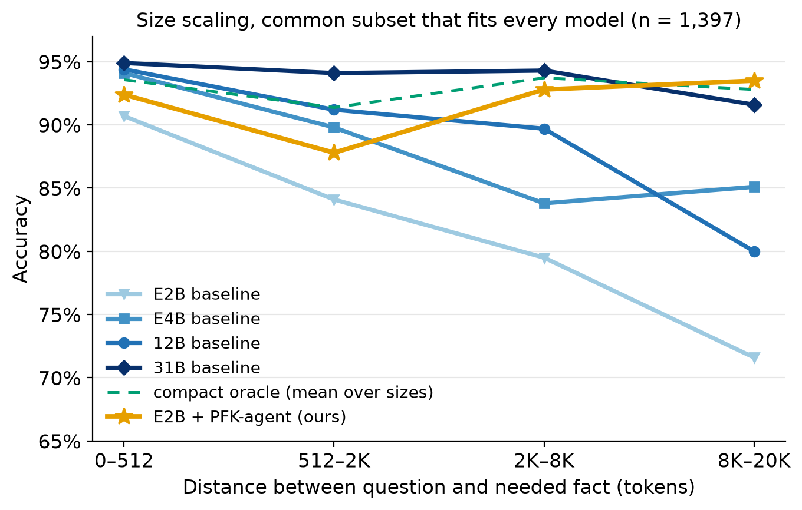
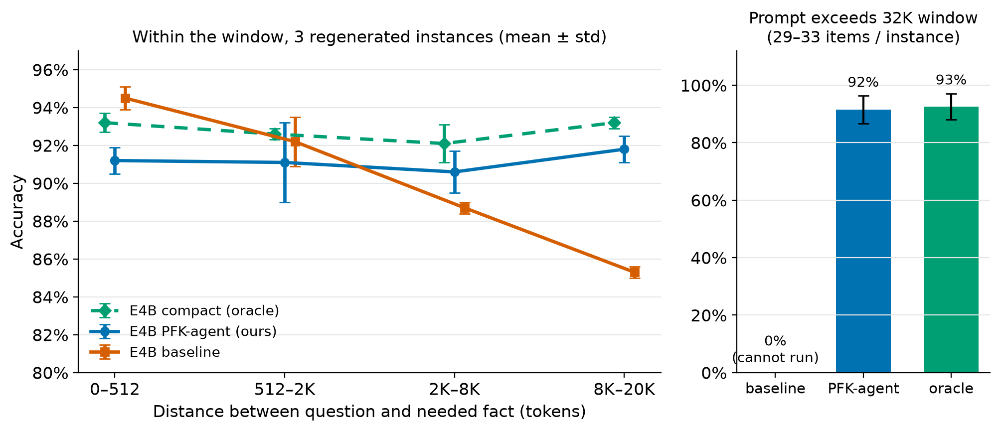

# RepoMem: Measuring and Repairing the Working-Memory Bottleneck in Small Gemma Code Agents

### A distance-controlled code-memory benchmark, and a graph-retrieval buffer that brings a 2B model to its oracle

**Track:** Gemma 4 Developer Agent — Paper Track · **Code:** https://github.com/leomaxuz/repomem (Apache-2.0) · companion Kaggle notebook

---

## Abstract

Small quantized models such as Gemma 4 E2B and E4B are attractive for local developer agents. But on real repositories, the fact needed to answer a question may sit thousands of tokens away from the question, or not fit in the context window at all. We introduce **RepoMem**, a benchmark generated automatically from the competition's code graphs. It holds a question and its answer fixed and varies only the amount of distractor code between them (`distance_tokens`). RepoMem has 1,554 well-posed, exactly scorable questions of three kinds (`defn`, `chain`, `caller`) over four Python libraries.

RepoMem separates **two failure regimes**. *Within the window*, accuracy decays with distance even though the model holds the knowledge: shown only the needed function, the same model answers the same question at a flat 89–93%. The decay is strongly size-dependent. E2B falls from 90.9% to 71.7% at 8–20K tokens, 20.7 points below its own oracle. Larger models lose far less (overall gap 9.3 points for E2B versus 0.7–4.7 for E4B, 12B and 31B). *Beyond the window*, 2.7% of prompts exceed 32K tokens, and no model can answer them from raw context. Thinking mode does not help.

We then propose **PFK-agent**, a working-memory architecture. It starts from the entity named in the question, walks the code graph with the neighbor and caller tools a Gemma developer agent already has, and answers from a small buffer. PFK-agent lifts E4B from 85.7% to 89.1% and **E2B from 79.8% to 91.3%**, matching E2B's oracle (91.4%). That puts E2B above the 12B baseline and within 2.4 points of 31B at 1/52 of its latency. PFK-agent also answers 81–88% of the questions that do not fit in the window. Results replicate on three regenerated instances. With a full-context fallback, PFK-agent stays robust when the model must ground the entity itself (88.5%) and when 30% of graph edges are missing (88.4%).

---

## 1. Introduction

A developer agent built on a small model rarely fails because it lacks knowledge of a function. More often the function is buried under unrelated code, or lies outside the context entirely. Gemma 4's small models rely mostly on sliding-window attention, which is efficient but limits how reliably they use distant context.

Generic long-context probes plant a random sentence in prose. They miss the structured version of the problem that code agents face: the needle is a function, the distractors are plausible sibling functions, and the question is about a relationship. We contribute:

1. **RepoMem**, an automatic, distance-controlled, exactly scorable benchmark built from code graphs. Its well-posedness filter also exposes reversed `calls` edges in the source graphs (§3).
2. A **measurement** of two regimes: within-window decay, which is far worse for the smallest model, and a hard beyond-window ceiling that scale does not remove. An oracle control shows the knowledge is present (§5).
3. **PFK-agent**, a tool-grounded working-memory buffer that recovers the oracle without oracle information. We ablate entity grounding, graph noise, and routing (§6).

---

## 2. Related Work

**Long context.** Models under-use long inputs. Liu et al. [1] find a U-shaped "lost in the middle" position effect, and needle-in-a-haystack tests [2] probe verbatim recall of one sentence. RepoMem uses a code-structured haystack, asks *relational* questions, and sweeps distance explicitly. Sliding-window attention [4] is the regime where a memory bottleneck should dominate.

**Repository-level code benchmarks.** RepoBench [6], CrossCodeEval [7], and SWE-bench [5] measure end-task success, which entangles retrieval, knowledge, and reasoning. RepoMem is diagnostic: it isolates memory and complements those suites.

**Retrieval and external memory.** Retrieval augmentation [3] and neural external memory [10] motivate a small, actively managed buffer, and cognitive models of prefrontal working memory [9, 11] motivate gating what enters it. PFK-agent builds this buffer from the competition's own graph tools rather than an external vector index, so it transfers directly to the Gemma agent setting.

---

## 3. The RepoMem Benchmark

**Source.** Each competition code graph has nodes (function/class `id`, `name`, source `text`) and `calls` edges. We use all 127 unique graphs of fastapi, rich, requests, and httpx. Each item is a JSONL record `{id, repo, kind, k, distance_tokens, n_items, prompt, answer, meta}`. The prompt is a list of fenced function blocks followed by a question.

**Probes.**
- `defn`: list the parameters of a named function among *N* shown.
- `chain`: follow a call chain from a named function for exactly *k* steps and name the function reached.
- `caller`: name the shown function that calls a named target.

**Well-posedness.** Every answer is unique and grounded in the shown code:
- Every `chain` step has exactly one in-graph callee, and every `caller` target has exactly one in-graph caller.
- Every step must be **visible as a call (`name(`) in the caller's source**.
- Parameters come from the Python AST, excluding `self`/`cls`.
- The verbatim question is stored, so every condition asks the identical question.

The visibility check matters. Among the 508 chain candidates, **97 (19%) relied on a `calls` edge that does not appear in the source**. In the cases we inspected, the edge points from callee to caller: the graph says `fake_password_hasher → fake_save_user`, but it is `fake_save_user` that calls `fake_password_hasher`. These items have an unanswerable gold answer (even the oracle scores 37% on them, against 83% on the rest). The generator drops them *after* sampling, so the remaining 1,554 items are identical with or without the filter. Scoring is deterministic (a parameter-set or function-name match) with no LLM judge.

**Composition.** `distance_tokens` counts the distractor tokens between the question and the needed fact (0 to ~33K). It is bucketed as 0–512 / 512–2K / 2K–8K / 8K–20K / 20K+ (369 / 360 / 501 / 283 / 41 items). The set has 635 `defn`, 411 `chain`, and 508 `caller` items.

**The window.** Total prompt length can exceed distance: **42 items (2.7%) have prompts longer than the 32K serving window** and cannot be run as full-context prompts. We report them separately throughout as *beyond-window*. The other 1,512 items are *in-window*.

---

## 4. Setup

**Models and serving.** We evaluate the competition's int4 QAT checkpoints `gemma-4-{e2b,e4b,12b,31b}-it-qat-w4a16-ct` on vLLM 0.33.0 with 2× RTX 4090 (tensor parallelism 2), greedy decoding, and thinking off unless stated. The window is `max_model_len = 32768`.

**31B and the common subset.** 31B's KV cache fits only 16K tokens on this hardware. Cross-size comparisons therefore use the **1,397 items that fit every model**.

**Conditions.**
- *Baseline*: the full prompt.
- *Oracle (compact)*: only the needle block(s), with the same question. This is an upper bound that uses ground truth.
- *PFK-agent* (§6).
- *Thinking*: a random sample of the main set.

---

## 5. Measuring the Bottleneck

*Figure 1. The two regimes on the main set.*

### 5.1 Within the window: decay with distance, knowledge intact

| distance | n | E4B base | E4B oracle | E2B base | E2B oracle |
|---|---|---|---|---|---|
| 0–512 | 364 | 94.2 | 92.6 | 90.9 | 92.9 |
| 512–2K | 359 | 90.0 | 90.8 | 84.4 | 88.0 |
| 2K–8K | 496 | 84.1 | 91.3 | 79.6 | 92.5 |
| 8K–20K | 276 | 84.8 | 88.8 | **71.7** | 92.4 |
| 20K+ (fits) | 17 | 88.2 | 88.2 | 76.5 | 88.2 |

Shown only the needle, both models stay flat (88–93%). The decay is therefore not a knowledge or reasoning gap: the model fails to *retrieve* a fact it can use, which is a working-memory limit. E4B loses up to 7.2 points to its oracle. E2B loses **20.7 points** at 8–20K, even though its oracle (91.5% in-window) is as high as E4B's (91.0%). The smaller model knows enough to answer; it cannot find the fact among distractors.

### 5.2 Scaling: the smallest model suffers most

*Figure 2. Four sizes on the 1,397 items that fit every model. The orange line is E2B with PFK-agent.*

| model | baseline | oracle | gap 2K–8K | gap 8K–20K | s/query |
|---|---|---|---|---|---|
| E2B | 82.3 | 91.6 | 13.3 | **21.9** | 2.05 |
| E4B | 88.1 | 91.0 | 7.6 | 3.3 | 3.56 |
| 12B | 89.8 | 94.5 | 4.8 | 13.5 | 6.91 |
| 31B | 94.0 | 94.7 | 1.9 | 4.2 | 11.54 |
| **E2B + PFK** | **91.6** | — | — | — | **0.22** |

The oracle varies little with size (91.0–94.7%), but the baseline's distance penalty does not. E2B is the clear outlier, with an overall gap of 9.3 points versus 2.9 / 4.7 / 0.7 for E4B / 12B / 31B. Above E2B the trend is not monotone: 12B, whose checkpoint uses a different (unified multimodal) architecture, is weak at 8–20K. The bottleneck is largest for exactly the most deployable model.

### 5.3 Beyond the window: a ceiling scale cannot remove

On the 42 beyond-window items the baseline returns nothing, and larger models do not help. They share the 32K window, and 31B on our hardware fits only 16K, which leaves 157 items unservable. RepoMem prompts reach ~110K tokens; real repositories are far larger. The oracle and PFK-agent read a small buffer and answer these items at 83.3% and **81.0%** (E4B), and 88.1% and **88.1%** (E2B).

### 5.4 Thinking and position do not explain it

Thinking leaves accuracy unchanged: 90.1% versus 89.8% for the baseline on the same 353 sampled in-window items. Bucketing long-context (≥ 4K) E4B accuracy by the needle's relative position in the prompt gives 80.5 / 86.6 / **86.5** / 84.0 / 82.0%. The middle is *best*, so there is no lost-in-the-middle U-shape [1]. Distance, the variable RepoMem controls, is the primary axis.

---

## 6. PFK-agent: A Graph-Retrieval Working Memory

**Method.** PFK-agent treats the entity named in the question as a handle into the repository. It builds a compact buffer with the operations exposed to a Gemma developer agent (`get_code_neighbors` / `get_code_subgraph`):
- `defn`: fetch the named block.
- `chain`: walk `calls` edges from the named start, one deterministic step at a time.
- `caller`: follow reverse edges from the named target.

It then answers from the buffer alone. It never reads the stored answer path or the oracle needle set.

### 6.1 Main result

| | E4B base | **E4B PFK** | E4B oracle | E2B base | **E2B PFK** | E2B oracle |
|---|---|---|---|---|---|---|
| 0–512 | 94.2 | 90.1 | 92.6 | 90.9 | 92.6 | 92.9 |
| 2K–8K | 84.1 | **89.7** | 91.3 | 79.6 | **92.5** | 92.5 |
| 8K–20K | 84.8 | **88.0** | 88.8 | 71.7 | **92.4** | 92.4 |
| beyond window | 0.0 | **81.0** | 83.3 | 0.0 | **88.1** | 88.1 |
| all 1,554 | 85.7 | **89.1** | 90.8 | 79.8 | **91.3** | 91.4 |

Graph retrieval succeeds on 100% of items.

On E4B, PFK recovers **67% of the oracle headroom** and comes within 0.8–2.3 points of the oracle wherever the bottleneck bites (2K–20K and beyond the window). At short distance it trails the baseline by 4.1 points. When the needle is adjacent to the question the full context is free, and the bare buffer drops useful surroundings.

On E2B, PFK **matches the oracle** in every bucket. On the common subset, E2B + PFK (91.6%) is above the E4B and 12B baselines (88.1%, 89.8%) and 2.4 points below 31B (94.0%), at 1/52 of 31B's latency (0.22 s vs 11.54 s per query). 31B cannot serve 157 of the items at all. PFK is ~10× faster than the E4B baseline (0.34 s vs 3.56 s), and its latency is flat in distance because the buffer does not grow.

By kind (E4B), `caller` gains most (93.3% → 98.4%, equal to the oracle), since reverse-edge lookup is exactly what scanning fails at. `chain` improves from 76.4% to 83.2% (oracle 82.7%). `defn` is unchanged (85.7% vs 85.5%).

Baseline failures typically name a *real, plausible neighbor* (e.g. `get_current_version` instead of `update_version_file` in a 22.6K-token chain). This is the signature of interference, not missing knowledge.

### 6.2 Robustness across benchmark instances

*Figure 3. Mean ± std over three regenerated instances (seeds 1–3, 1,410–1,423 well-posed items each, E4B).*

| | 0–512 | 512–2K | 2K–8K | 8K–20K | beyond | all |
|---|---|---|---|---|---|---|
| baseline | 94.5±0.6 | 92.2±1.3 | 88.7±0.3 | **85.3±0.3** | 0.0 | 88.3±0.4 |
| PFK | 91.2±0.7 | 91.1±2.1 | 90.6±1.1 | **91.8±0.7** | 91.5±4.8 | 91.2±0.9 |
| oracle | 93.2±0.5 | 92.6±0.3 | 92.1±1.0 | 93.2±0.3 | 92.6±4.5 | 92.7±0.4 |

On fresh instances the baseline decays *monotonically* (94.5% → 85.3%), while PFK and the oracle stay flat. The 8–20K gap between the baseline and PFK (6.5 points) is about ten times the across-instance standard deviation.

### 6.3 Ablations: grounding, graph noise, routing (E4B, all 1,554 items)

| variant | accuracy |
|---|---|
| PFK, entity given | 89.1 |
| entity extracted by Gemma, naive name lookup | 74.2 |
| … + verification against the question + full-context fallback | **88.5** |
| only the bare function name visible (+ verification, fallback) | 86.2 |
| 10% / 30% of `calls` edges removed | 84.6 / 77.6 |
| 30% removed + full-context fallback when retrieval is incomplete | **88.4** |
| baseline (for reference) | 85.7 |

*Grounding.* When Gemma must name the entity itself, a naive lookup fails. The model often returns the bare name, and fastapi's documentation tutorials repeat names such as `get_user` across many modules (up to 45 same-named candidates). The fix is to accept the model's answer only when it is unambiguous or literally present in the question, and otherwise fall back to the full context. This restores 88.5%. With only bare names visible, half the items are ambiguous, yet the agent still beats the baseline (86.2% vs 85.7%).

*Graph noise.* Missing edges, as from dynamic dispatch, break chain walks (77.6% at 30% removal). The same fallback, triggered on 18% of items, recovers 88.4%.

*Routing.* A prompt-length router (full context below a threshold, PFK above it) had its threshold chosen on seed 1 (8K tokens) and frozen. On the held-out sets it does not beat PFK alone (−0.5 points on average). Simple routing adds nothing; PFK alone is already within ~2 points of the oracle.

---

## 7. Limitations

- **Graph as ground truth.** RepoMem is built from, and PFK retrieves over, the same graph. §3 shows such graphs contain reversed edges. §6.3 bounds the effect of edge loss, but real failures are structured, not random.
- **Synthetic single-turn questions** isolate memory but are not natural developer requests. They complement end-to-end suites.
- **Small long-distance sets.** The 20K+-fitting bucket has 17 items and the beyond-window set 42 (29–33 per instance).
- **Hardware-bounded scaling.** 31B is compared at a 16K window, and 12B differs architecturally from the other sizes.
- **Scope.** Four Python libraries and three probe kinds.

---

## 8. Conclusion

RepoMem turns "small models forget things far away" into a controlled measurement and separates two phenomena. Within the window, small Gemma models lose facts they demonstrably know, and the loss is by far the largest for E2B. Beyond the window, no model of any size can answer from raw context.

PFK-agent addresses both regimes. It is a minimal working-memory buffer built from the graph tools a Gemma agent already has. It brings the smallest, cheapest model exactly to its oracle and above the 12B baseline. It stays robust when the agent grounds entities itself or the graph is incomplete, and it runs 10–50× faster than reading the context. Building the benchmark also surfaced reversed edges in the competition code graphs, a caution for any agent that trusts graph tools blindly.

---

## Reproducibility

All code is released under Apache-2.0 at https://github.com/leomaxuz/repomem:
- `generate.py`: the benchmark generator. `--per-repo 20 --seed 1` reproduces the 1,554 items.
- `evaluate.py`: baseline, oracle, and thinking runs.
- `pfk_agent.py`: PFK-agent, with `--entity-mode`, `--verify-entity`, `--edge-drop`, and `--fallback-full`.
- `recompute_all.py`: produces every number in this paper from the per-item outputs.
- `router.py`, `plot_figures_v2.py`, and the vLLM serving scripts.

A companion Kaggle notebook regenerates the benchmark from the competition data, checks well-posedness, and reruns PFK retrieval offline. The competition graphs and the items generated from them are Competition Data and are not redistributed.

## References

[1] Liu et al. Lost in the Middle: How Language Models Use Long Contexts. TACL 2024.
[2] G. Kamradt. Needle In A Haystack — Pressure Testing LLMs. 2023.
[3] Lewis et al. Retrieval-Augmented Generation for Knowledge-Intensive NLP Tasks. NeurIPS 2020.
[4] Beltagy, Peters, Cohan. Longformer: The Long-Document Transformer. arXiv:2004.05150, 2020.
[5] Jimenez et al. SWE-bench: Can Language Models Resolve Real-World GitHub Issues? ICLR 2024.
[6] Liu, Xu, McAuley. RepoBench: Benchmarking Repository-Level Code Auto-Completion Systems. ICLR 2024.
[7] Ding et al. CrossCodeEval: A Diverse and Multilingual Benchmark for Cross-File Code Completion. NeurIPS 2023.
[8] Gemma Team. Gemma: Open Models Based on Gemini Research and Technology. 2024.
[9] A. Baddeley. Working Memory: Looking Back and Looking Forward. Nat. Rev. Neurosci. 2003.
[10] Graves et al. Hybrid Computing Using a Neural Network with Dynamic External Memory. Nature 2016.
[11] O'Reilly, Frank. Making Working Memory Work: A Computational Model of Learning in the Prefrontal Cortex and Basal Ganglia. Neural Computation 2006.
