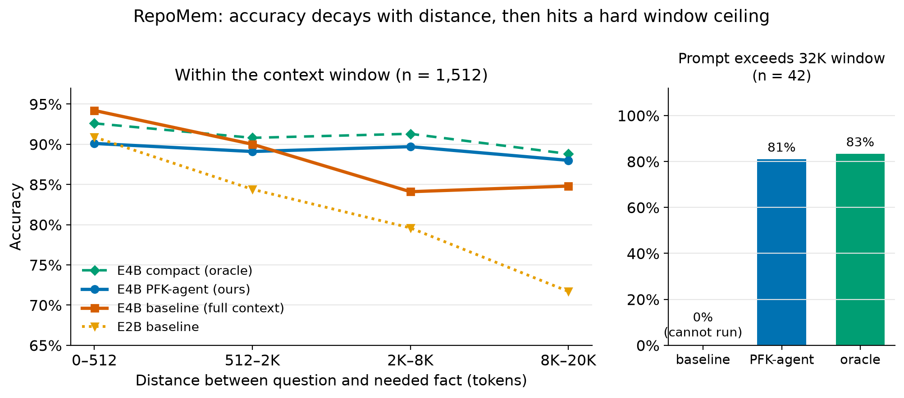
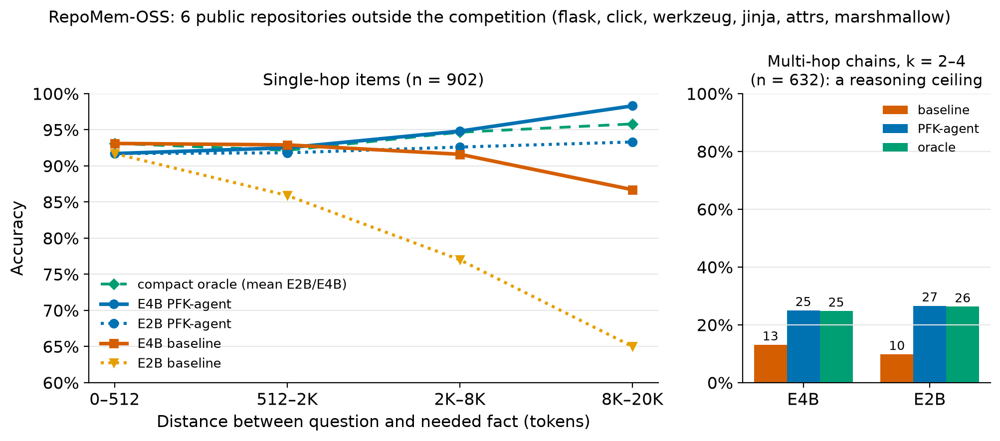
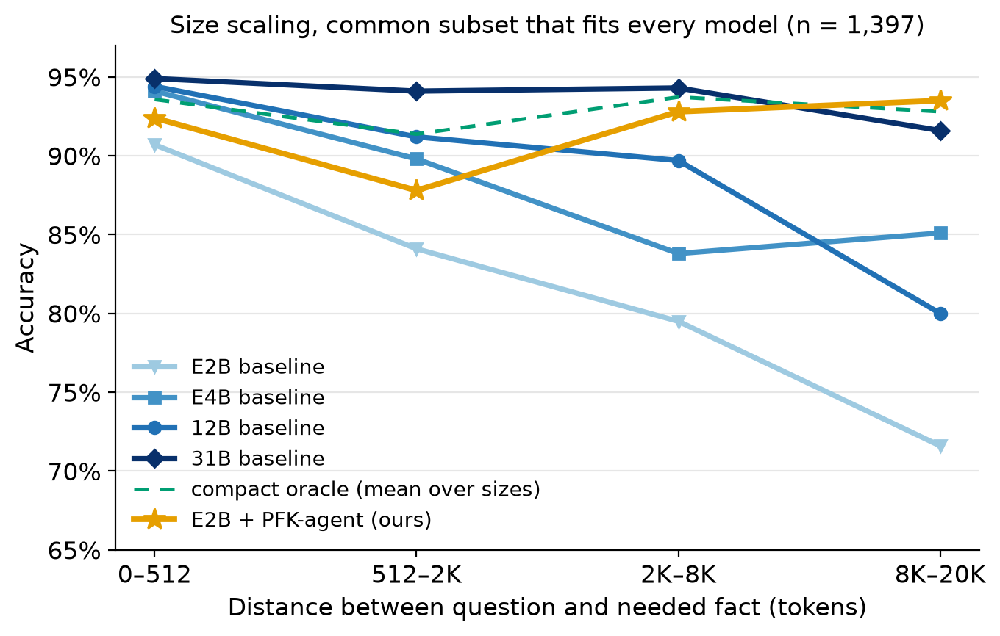

# RepoMem

**Measuring and repairing the working-memory bottleneck in small Gemma code agents.**

Companion code for the Gemma 4 Developer Agent — Paper Track submission
*"RepoMem: Measuring and Repairing the Working-Memory Bottleneck in Small Gemma Code Agents"* ([PAPER.md](PAPER.md) · [PAPER.pdf](PAPER.pdf)).

RepoMem is a distance-controlled benchmark for code language models. It holds a question about a repository and its answer fixed, and varies only the amount of distractor code between the question and the fact needed to answer it (`distance_tokens`). Items are generated automatically from repository code graphs, so the benchmark can be rebuilt for any repository with such a graph. Scoring is exact, with no LLM judge.

**PFK-agent** is a working-memory architecture. It starts from the entity named in the question, walks the code graph with the neighbor and caller tools a Gemma developer agent already has, and answers from a small buffer instead of the full context.



## Key results (Gemma 4, int4 QAT, vLLM, 2× RTX 4090)

- **Within the 32K window**, accuracy decays with distance even though the model holds the knowledge: shown only the needed function, it answers at a flat 89–93%. E2B falls from 90.9% to 71.7% at 8–20K tokens, 20.7 points below its oracle. Larger models lose far less: the overall gap is 9.3 points for E2B versus 2.9 / 4.7 / 0.7 for E4B / 12B / 31B.
- **Beyond the window** (2.7% of items), no model can answer from the raw context.
- **PFK-agent** lifts E4B from 85.7% to 89.1% and **E2B from 79.8% to 91.3%**, matching E2B's oracle (91.4%). That is above the 12B baseline and 2.4 points below 31B, at 1/52 of 31B's latency.
- PFK-agent is robust to self-grounded entities (88.5%) and to 30% missing graph edges (88.4% with a full-context fallback).
- All results replicate on 3 regenerated benchmark instances.
- **Data finding:** 19% of raw chain candidates relied on `calls` edges that do not appear in the source (in the cases we inspected, they point callee → caller). The generator filters these items out (1,651 → 1,554 well-posed items).
- **[RepoMem-OSS](benchmark/repomem-oss/)** is a fully open companion benchmark: 1,534 items from flask, click, werkzeug, jinja, attrs and marshmallow, with graphs built by `build_graph.py`. The same pattern holds there. On single-hop items, E2B falls from 91.7% to 65.0% with distance, and PFK-agent restores it to 93.3%. Multi-hop chains expose a reasoning ceiling: even the oracle scores only ~25%.





## Repository layout

| path | contents |
|---|---|
| `code/repomem/` | benchmark generator, code-graph builder (`build_graph.py`), evaluator, PFK-agent, analysis and plotting ([details](code/repomem/README.md)) |
| `benchmark/repomem-oss/` | **RepoMem-OSS**: the open benchmark (items, graphs, manifest, source licenses) |
| `scripts/` | vLLM serving (`serve_model.sh`, `serve_e4b.sh`, `serve_e2b.sh`) and the experiment chains used for the paper |
| `notebook/repomem_kaggle.ipynb` | Kaggle notebook: regenerates the benchmark from competition data, checks it, runs PFK retrieval offline, renders the results |
| `experiments/` | aggregate results (JSON / Markdown) behind every table in the paper |
| `figures/` | paper figures |

## Quick start

```bash
# 1. build the benchmark from a directory of <repo>_<sha>.json code graphs
python code/repomem/generate.py --graphs <graphs_dir> --out tasks.jsonl --per-repo 20 --seed 1

# 2. serve a model (any OpenAI-compatible endpoint works)
bash scripts/serve_model.sh <model_path> gemma 8000 32768 0.90

# 3. evaluate: full-context baseline, compact oracle, PFK-agent
python code/repomem/evaluate.py  --tasks tasks.jsonl --model gemma --out base.jsonl
python code/repomem/evaluate.py  --tasks tasks.jsonl --model gemma --out oracle.jsonl --compact --graphs <graphs_dir>
python code/repomem/pfk_agent.py --tasks tasks.jsonl --model gemma --out pfk.jsonl --graphs <graphs_dir>

# PFK-agent ablations
python code/repomem/pfk_agent.py ... --entity-mode model --verify-entity --fallback-full   # model grounds the entity
python code/repomem/pfk_agent.py ... --edge-drop 0.3 --fallback-full                      # noisy graph

# 4. report
python code/repomem/summarize.py --out REPORT.md --add "baseline:base.jsonl" --add "PFK:pfk.jsonl" --add "oracle:oracle.jsonl"
```

The scripts in `scripts/` were written for our server layout (`~/gemma4-paper`, `bin/`); adjust the paths to your setup.

## Data

**RepoMem-OSS** (in `benchmark/repomem-oss/`) is freely downloadable. It is built only from public, permissively licensed repositories, and their licenses are included.

The competition code graphs and the benchmark items generated from them are **Competition Data** of the Gemma 4 Developer Agent competition, so **they are not redistributed here**. `generate.py` rebuilds the exact benchmark deterministically from the competition data. It also accepts any repository code graph in the same NetworkX-JSON format (nodes with `id`/`name`/`text`, `calls` edges).

## License

Code: [Apache License 2.0](LICENSE).
